<!--
╔══════════════════════════════════════════════════════════════════════════╗
║  JAYAMEENAKSHI · GITHUB PROFILE README                                   ║
║  Repo name must be EXACTLY your username:  Jayameenakshi/Jayameenakshi   ║
║  Search this file for "EDIT:" to find every place you need to change.    ║
╚══════════════════════════════════════════════════════════════════════════╝
-->

<!-- ═══════════════════════ 1. HERO ═══════════════════════ -->


 

<!-- EDIT: change "Jayameenakshi" if your GitHub username is different -->

  

<!-- EDIT: replace YOUR_LINKEDIN_URL, YOUR_EMAIL and YOUR_PORTFOLIO_URL -->

 

<!-- ═══════════════════════ 2. 3D DEVELOPER INTRO ═══════════════════════ -->


 

<!-- ═══════════════════════ 3. ABOUT ME ═══════════════════════ -->


I'm a passionate <b>Full Stack Web Developer</b> who enjoys creating modern, beautiful, and user-friendly websites. 
I love learning new technologies and turning ideas into real-world projects.

 

<!-- ═══════════════════════ 4. TECH STACK ═══════════════════════ -->


 

 

 

 

<!-- ═══════════════════════ 5. GITHUB STATISTICS ═══════════════════════
     All numbers come live from GitHub via public services. Nothing is hard-coded.
     EDIT: replace "Jayameenakshi" in every URL below if your username differs.
     Note: these services run on free servers and occasionally rate-limit; they recover on their own. -->


 

 

 

 

<!-- ═══════════════════════ 6. CONTRIBUTION GRAPH ═══════════════════════ -->


<h3>💜 My Coding Journey</h3>

 

<!-- ═══════════════════════ 7. 3D CONTRIBUTION VISUAL ═══════════════════════ -->


 

<!-- ═══════════════════════ 8. SKILLS CHART ═══════════════════════ -->


 

<!-- ═══════════════════════ 9 + 10. PROJECT SHOWCASE ═══════════════════════
     EDIT: for every project replace
         YOUR_PROJECT_GITHUB_URL  -> link to that project's repository
         YOUR_LIVE_DEMO_URL       -> link to the deployed demo (delete the Live Demo badge if there is none)
     EDIT: tech-stack chips inside each card SVG are best guesses. Change them in
           assets/card-*.svg (search for the chip names) or tell me and I'll regenerate. -->


<!-- FEATURED -->
<a href="YOUR_PROJECT_GITHUB_URL"></a>

<b>💼 AI Career Advisor</b> — An AI-powered career guidance platform that helps users explore skills, courses, and personalized career roadmaps.

  

<table>
<tr>
<td align="center" width="50%">
<a href="YOUR_PROJECT_GITHUB_URL"></a>

<b>📰 Newsify</b> A modern news app that delivers categorized, up-to-date headlines in a clean, responsive reading experience.

</td>
<td align="center" width="50%">
<a href="YOUR_PROJECT_GITHUB_URL"></a>

<b>🏦 Banking Management System</b> A secure banking platform for managing accounts, transactions, and customer operations through a clear dashboard.

</td>
</tr>
<tr>
<td align="center" width="50%">
<a href="YOUR_PROJECT_GITHUB_URL"></a>

<b>🌐 Personal Portfolio</b> My animated developer portfolio showcasing projects, skills, and experience.

</td>
<td align="center" width="50%">
<a href="YOUR_PROJECT_GITHUB_URL"></a>

<b>🛍️ E-Commerce Website</b> A full online store with product browsing, cart, authentication, and an admin-ready workflow.

</td>
</tr>
<tr>
<td align="center" colspan="2">
<a href="YOUR_PROJECT_GITHUB_URL"></a>

<b>🔐 Explainable AI-Based Phishing Website Detection System</b> A machine-learning system that detects phishing websites and explains every prediction with explainable-AI techniques.

</td>
</tr>
</table>

 

<!-- ═══════════════════════ 11. CURRENTLY LEARNING ═══════════════════════ -->


 

<!-- ═══════════════════════ 12. CODING JOURNEY ═══════════════════════ -->


 

<!-- ═══════════════════════ 13. GITHUB TROPHIES ═══════════════════════ -->


 

<!-- ═══════════════════════ 14. DEVELOPER QUOTE ═══════════════════════
     A new random quote loads each time the page is viewed. -->


 

<!-- ═══════════════════════ 15. CONNECT WITH ME ═══════════════════════
     EDIT: YOUR_LINKEDIN_URL, YOUR_EMAIL, YOUR_PORTFOLIO_URL -->


 

<!-- ═══════════════════════ 16. FOOTER ═══════════════════════ -->


