# 👋 Hi, I'm Jayameenakshi

### 💻 Full Stack Web Developer | MERN Stack Enthusiast

I'm a passionate Full Stack Web Developer who enjoys creating modern, beautiful, and user-friendly websites. I love learning new technologies and turning ideas into real projects.

---

### 🛠️ Tech Stack

- HTML
- CSS
- JavaScript
- React.js
- Node.js
- Express.js
- MongoDB
- Bootstrap
- Git & GitHub

### 🚀 What I'm Doing

- 🌱 Learning Full Stack Development
- 💻 Building real-world projects
- 🤖 Exploring AI technologies
- 📚 Improving my coding skills

### 📌 Featured Projects

- 💼 AI Career Advisor
- 📰 Newsify
- 🏦 Banking Management System
- 🛍️ E-Commerce Website
- 🌐 Personal Portfolio

### 📫 Connect With Me

- GitHub: [@JayameenakshiSS](https://github.com/)
- LinkedIn: [My LinkedIn](https://www.linkedin.com/)

---

⭐ Thanks for visiting my profile!
